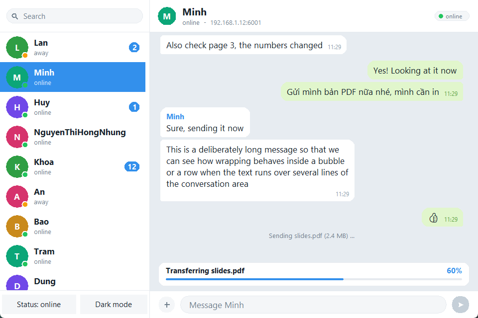
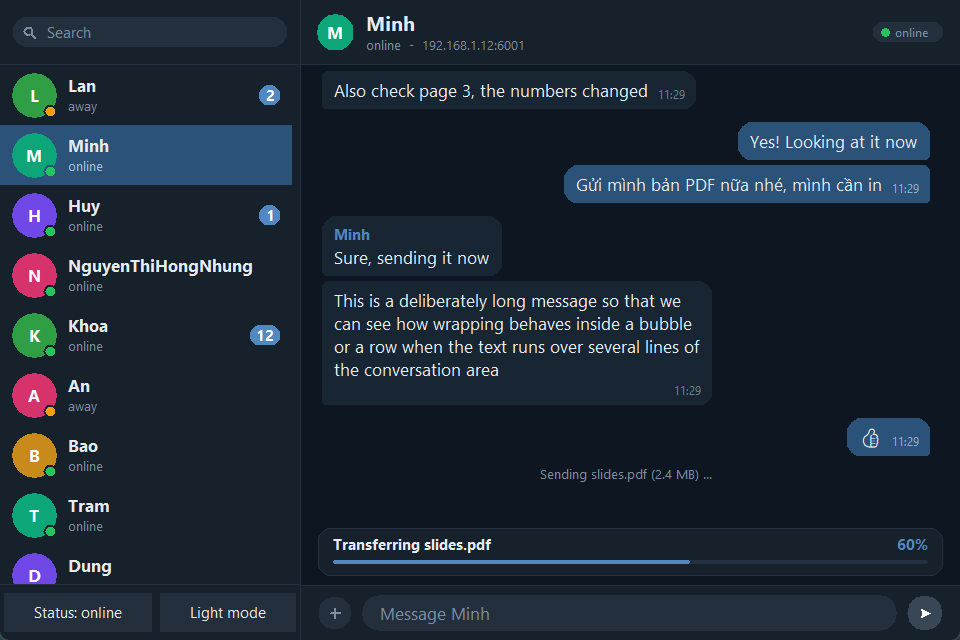

# Hướng dẫn dùng giao diện cửa sổ (GUI)

Giao diện cửa sổ là cách dùng LAN Chat không cần gõ lệnh. Nó dùng chung lõi với bản console, nên mọi tính năng (tìm người, chat, gửi file, trạng thái) đều giống hệt.



## 1. Mở chương trình

```bash
python main.py --name Quan --gui
```

Các tham số khác giống bản console (`--port`, `--udp-port`, `--broadcast`, `--downloads`), xem [README](../README.md#chạy). Thử nhiều cửa sổ trên một máy: mỗi cửa sổ một cổng TCP riêng.

```bash
python main.py --name Quan --port 5001 --broadcast 127.255.255.255 --gui
python main.py --name Minh --port 5002 --broadcast 127.255.255.255 --gui
```

Cần `tkinter`. Windows và macOS đã có sẵn. Ubuntu cài thêm: `sudo apt install python3-tk`. Lần đầu chạy trên Windows, nếu Firewall hỏi thì chọn **Allow** cho Python, nếu không sẽ không thấy ai.

## 2. Các khu vực của cửa sổ

| Khu vực | Nội dung |
|---|---|
| Cột trái, trên cùng | Ô **Search**: gõ để lọc danh sách theo tên |
| Cột trái, giữa | Người đang online: avatar màu, tên, trạng thái, chấm xanh (online) hoặc cam (away), huy hiệu số tin chưa đọc |
| Cột trái, dưới cùng | Nút **Status** (đổi online/away) và nút **Dark mode** (đổi sáng/tối) |
| Thanh tiêu đề | Tên người đang chat, trạng thái, địa chỉ IP và cổng của họ |
| Khung giữa | Hội thoại: tin nhắn dạng bong bóng và các thông báo của chương trình |
| Hàng dưới cùng | Nút **+** gửi file, ô nhập tin, nút gửi |

## 3. Chat với một người

1. Chờ người đó xuất hiện ở cột trái (khoảng 3 giây sau khi họ mở chương trình).
2. **Bấm vào tên** của họ. Hàng đó được tô xanh đặc, thanh tiêu đề hiện tên họ, chương trình tự kết nối.
3. Gõ tin vào ô nhập rồi nhấn **Enter** (hoặc bấm nút gửi). Ô nhập có chữ gợi ý `Message <tên>`.
4. Tin của bạn là bong bóng xanh lá nhạt bên phải, tin của họ là bong bóng trắng bên trái kèm giờ gửi.

Tin liên tiếp của cùng một người trong vòng 5 phút được gộp thành một nhóm: tên chỉ hiện ở tin đầu, giờ ở tin cuối. Nhãn **Today** ngăn cách các ngày.

Đang gõ dở mà có tin đến thì chữ bạn đang gõ vẫn còn nguyên.

## 4. Tin nhắn từ người khác

- Nếu họ **không phải người đang chat** với bạn, cột trái hiện huy hiệu số tin chưa đọc cạnh tên họ, và khung chat hiện thông báo `New message from <tên> (n unread)`.
- Bấm vào tên họ để chuyển sang chat đó: các tin chưa đọc hiện ra ngay, huy hiệu biến mất.
- Thông báo (người vào mạng, người thoát, kết nối bị mất) hiện ở giữa bằng chữ nhỏ, lỗi màu đỏ. Chúng vẫn hiện kể cả khi bạn chưa chọn ai.

## 5. Gửi file

1. Chọn người cần gửi (phải đang chat với họ).
2. Bấm nút **+** ở góc trái ô nhập, chọn file.
3. Phía trên ô nhập hiện thẻ tiến độ gồm tên file và phần trăm. Bạn vẫn chat bình thường trong lúc gửi.
4. Gửi xong, thẻ biến mất và khung chat báo `Sent <file> ... 100%  Done.`

Bên nhận: file lưu vào thư mục `downloads/` (hoặc thư mục đặt bằng `--downloads`), khung chat báo `Received <file> -> <đường dẫn>`. Trùng tên thì file mới được đổi thành `ten (1).pdf`, `ten (2).pdf`.

## 6. Trạng thái và giao diện

- **Status: online / away**: bấm để đổi, những người khác thấy sau khoảng 1 giây (chấm đổi màu).
- **Dark mode / Light mode**: bấm để đổi giao diện, hội thoại đang có được giữ nguyên.



## 7. Gõ lệnh trong ô nhập

Ô nhập cũng nhận các lệnh của bản console, vẫn dùng được bình thường:

| Lệnh | Tác dụng |
|---|---|
| `/list` | Liệt kê người đang online |
| `/chat <tên>` | Mở chat với một người (giống bấm vào tên) |
| `/send <file>` | Gửi file (giống nút **+**) |
| `/leave` | Đóng cuộc chat hiện tại, tin chưa đọc vẫn được giữ |
| `/status online` hoặc `/status away` | Đổi trạng thái |
| `/help` | Hiện danh sách lệnh |
| `/quit` | Thoát chương trình |

Đóng cửa sổ bằng nút X cũng thoát gọn chương trình.

## 8. Cửa sổ nhỏ

Cửa sổ có kích thước mặc định 960 x 640 và nhỏ nhất 640 x 440. Khi hẹp hơn 900 px, cột trái tự thu lại (250 px, rồi 220 px khi dưới 800 px) để khung chat luôn đủ rộng. Tên dài được rút bằng dấu ba chấm.

## 9. Gặp sự cố

| Hiện tượng | Cách xử lý |
|---|---|
| Không thấy ai ở cột trái | Cho Python qua Windows Firewall. Hai máy phải cùng mạng; mạng trường hoặc quán cà phê hay bật *client isolation*, thử hotspot điện thoại. Một máy nhiều cửa sổ thì thêm `--broadcast 127.255.255.255` |
| Báo `Address already in use` | Hai cửa sổ đang dùng cùng cổng, đổi `--port` |
| Lỗi `No module named tkinter` | Ubuntu: `sudo apt install python3-tk` |
| Bấm tên mà báo không kết nối được | Người đó vừa thoát hoặc mất mạng. Chờ họ xuất hiện lại rồi bấm lại |
| Chữ mờ hoặc nhoè trên màn hình độ phân giải cao | Dùng bản Python mới; chương trình đã bật chế độ chữ sắc nét cho Windows |
