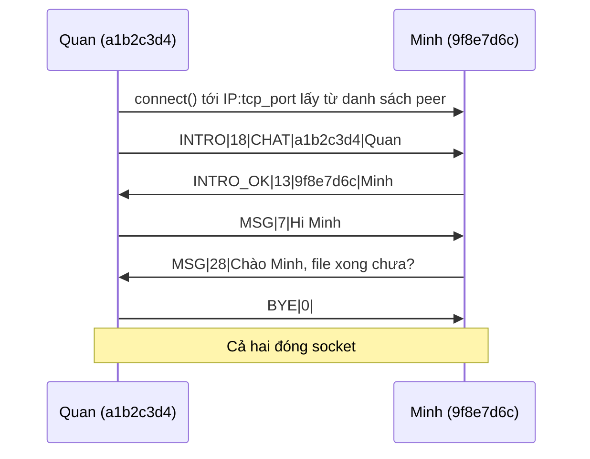
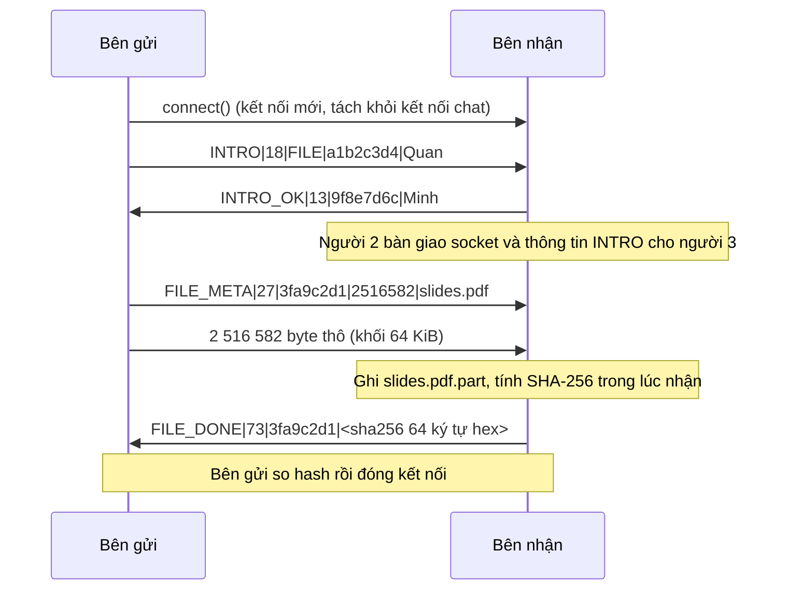

# Giao thức LAN Chat — v1

> **Trạng thái:** bản nháp, cần cả nhóm duyệt trước khi code.
> **Người giữ:** Người 2 giữ mục 2–5 (TCP). Người 1 giữ mục 1 (UDP).
> Mọi thay đổi định dạng phải sửa file này trước, rồi mới sửa code (xem mục 7).

Giao thức dựa trên ví dụ ở mục 5.2 của đề, có bổ sung bốn điểm. Lý do của từng điểm nên được ghi lại trong báo cáo:

| Bổ sung | Lý do |
|---|---|
| `peer_id` trong mọi định danh | Hai người có thể trùng tên. Khi một người khởi động lại, tên giữ nguyên nhưng phiên đã khác. |
| Frame mở đầu `INTRO` trên mọi kết nối TCP | Port nguồn TCP là port tạm, nên bên nhận không biết ai vừa kết nối nếu không được giới thiệu. Frame này cũng cho biết kết nối dùng để chat hay gửi file. |
| Kết nối TCP riêng cho mỗi lần gửi file | File lớn gửi trên socket chat sẽ chặn mọi tin `MSG` phía sau. Đề yêu cầu vẫn chat được trong lúc truyền file. |
| `FILE_DONE` kèm SHA-256 | Gửi đủ 100% không có nghĩa bên nhận đã lưu xong. Bên gửi chỉ báo thành công khi nhận được xác nhận này. |

---

## 0. Quy ước chung

- **Mã hoá:** mọi trường văn bản dùng UTF-8.
- **Độ dài** luôn tính bằng **byte** sau khi mã hoá UTF-8, không tính bằng ký tự. Ví dụ `Xin chào` có 8 ký tự nhưng dài 9 byte.
- **Số nguyên:** chữ số thập phân ASCII, không dấu, không có số 0 đứng đầu (trừ chính số `0`).
- **Dấu phân tách trường:** `|` (byte `0x7C`).
- **`peer_id`:** 8 ký tự hex thường, sinh ngẫu nhiên mỗi lần chạy chương trình (`secrets.token_hex(4)`). Đây là định danh thật của peer. Tên chỉ dùng để hiển thị.
- **`name`:** 1–20 ký tự. Không chứa `|`, khoảng trắng hay ký tự điều khiển. Không được chỉ gồm toàn chữ số, để `/chat <số>` không bị mơ hồ.
- **`file_id`:** 8 ký tự hex thường, sinh ngẫu nhiên cho mỗi lần gửi file.

## 1. UDP — discovery và trạng thái

Mỗi datagram chứa đúng một thông điệp văn bản, gửi broadcast tới cổng UDP **9999**.

### 1.1 Định dạng

```text
HELLO|<peer_id>|<name>|<tcp_port>|<status>
GOODBYE|<peer_id>
```

| Trường | Ràng buộc |
|---|---|
| `tcp_port` | 1–65535, là cổng TCP listener của peer |
| `status` | `online` hoặc `away` |

Ví dụ (31 byte):

```text
HELLO|a1b2c3d4|Quan|5000|online
```

Một datagram tối đa 512 byte.

### 1.2 Gửi

- Gửi `HELLO` ngay khi khởi động, sau đó cứ **3 giây** một lần.
- Gửi thêm một `HELLO` ngay khi người dùng đổi `/status`, không đợi chu kỳ 3 giây.
- Khi `/quit`, gửi `GOODBYE` 2 lần, cách nhau khoảng 100 ms. Mạng có thể làm mất gói, nên gửi 2 lần cho chắc. Nếu cả 2 gói đều mất, timeout sẽ xử lý.
- Địa chỉ đích mặc định là `255.255.255.255`. Khi chạy nhiều instance trên một máy không có mạng, dùng `127.255.255.255` (tham số `--broadcast`).

### 1.3 Nhận và kiểm tra

Bỏ qua im lặng (không báo lỗi, không crash) khi gặp một trong các trường hợp sau:

- Không giải mã được UTF-8, hoặc loại thông điệp không phải `HELLO`/`GOODBYE`.
- Sai số trường: `HELLO` phải đúng 5 trường, `GOODBYE` đúng 2 trường.
- `peer_id`, `name`, `tcp_port` hoặc `status` sai ràng buộc.
- `peer_id` trùng với `peer_id` của chính mình. Không so bằng IP, vì nhiều instance trên một máy dùng chung IP.

**IP của peer luôn lấy từ `recvfrom()`.** Không có trường nào trong gói chứa IP.

### 1.4 Cập nhật danh sách peer

| Tình huống | Hành động | Sự kiện |
|---|---|---|
| `peer_id` mới | Thêm peer | `PEER_ONLINE` |
| `peer_id` đã có, đổi `status`, `name`, `tcp_port` hoặc IP | Cập nhật | `PEER_UPDATED` |
| `peer_id` đã có, không đổi gì | Chỉ cập nhật `last_seen` | — |
| Nhận `GOODBYE` | Xoá peer | `PEER_OFFLINE` |
| Quá **10 giây** không nhận `HELLO` | Xoá peer | `PEER_OFFLINE` |

- `last_seen` dùng `time.monotonic()`. Luồng kiểm tra timeout quét mỗi 1 giây.
- Hai peer khác `peer_id` nhưng trùng tên vẫn được giữ cả hai. Khi đó `/chat <tên>` báo trùng và yêu cầu chọn theo số.

## 2. TCP — framing

### 2.1 Định dạng frame

Mọi thông điệp trên TCP có cùng một dạng:

```text
<TYPE>|<LEN>|<PAYLOAD>
```

| Phần | Ràng buộc |
|---|---|
| `TYPE` | 1–16 ký tự `A–Z` hoặc `_` |
| `LEN` | số byte của `PAYLOAD`, từ 0 đến `MAX_FRAME_PAYLOAD` (65 536) |
| `PAYLOAD` | đúng `LEN` byte, không có ký tự kết thúc |

Ví dụ: tin `Xin chào` được gửi thành `MSG|9|Xin chào`.

Ngoại lệ duy nhất là **dữ liệu file** (mục 4): sau frame `FILE_META`, bên gửi truyền thẳng đúng `size` byte thô, không bọc frame.

### 2.2 Cách đọc frame

1. Đọc **từng byte** cho đến khi gặp dấu `|` thứ hai. Nếu header vượt quá 32 byte mà chưa gặp, coi là lỗi giao thức.
2. Tách `TYPE` và `LEN`, kiểm tra ràng buộc.
3. Gọi `recv_exact(sock, LEN)`, tức lặp `recv()` cho đến khi đủ byte.

```python
def recv_frame(sock):
    header = b""
    while header.count(b"|") < 2:
        b = sock.recv(1)
        if not b:
            raise ConnectionClosed()
        header += b
        if len(header) > MAX_HEADER:          # 32
            raise ProtocolError("header too long")
    ftype, length, _ = header.split(b"|", 2)
    # kiểm tra ftype, length ...
    return ftype.decode("ascii"), recv_exact(sock, int(length))
```

> **Không được đọc dư.** Không bọc socket bằng `makefile()` hay bộ đệm tự viết có đọc trước. Trên kết nối file, byte thô nằm ngay sau `FILE_META`. Nếu đọc dư, người 2 sẽ nuốt mất phần đầu file trước khi bàn giao socket cho người 3.

### 2.3 Lỗi giao thức

Khi gặp `TYPE` lạ, `LEN` sai, payload sai cấu trúc hoặc frame không hợp lệ ở trạng thái hiện tại:

- Đóng kết nối ngay và phát `CONNECTION_CLOSED` với lý do `protocol_error`.
- Không cố đồng bộ lại luồng byte.

### 2.4 Bảng loại frame

| TYPE | Kết nối | Chiều | Payload |
|---|---|---|---|
| `INTRO` | chat, file | bên kết nối → bên nhận, luôn là frame đầu tiên | `<kind>\|<peer_id>\|<name>`, với `kind` là `CHAT` hoặc `FILE` |
| `INTRO_OK` | chat, file | bên nhận → bên kết nối | `<peer_id>\|<name>` của bên nhận |
| `INTRO_ERR` | chat, file | bên nhận → bên kết nối, sau đó đóng | `<code>\|<message>` |
| `MSG` | chat | hai chiều | văn bản một dòng, không chứa `\n` hoặc `\r` |
| `BYE` | chat | hai chiều | rỗng (`BYE\|0\|`) |
| `FILE_META` | file | gửi → nhận | `<file_id>\|<size>\|<filename>` |
| *(byte thô)* | file | gửi → nhận | đúng `size` byte |
| `FILE_DONE` | file | nhận → gửi | `<file_id>\|<sha256_hex>` |
| `FILE_ERR` | file | hai chiều, sau đó đóng | `<file_id>\|<code>\|<message>` |

Mã lỗi của `INTRO_ERR`:
- `BAD_INTRO`: frame đầu tiên không phải `INTRO`, hoặc sai cấu trúc.
- `DUPLICATE`: kết nối chat trùng (mục 3.2).
- `SHUTTING_DOWN`: bên nhận đang thoát.

Mã lỗi của `FILE_ERR`:
- `BAD_META`: `FILE_META` sai cấu trúc hoặc tên file không hợp lệ.
- `TOO_LARGE`: file vượt giới hạn kích thước.
- `IO_ERROR`: không ghi hoặc không đọc được file.
- `CANCELLED`: một bên thoát giữa chừng.

`filename` là trường cuối của `FILE_META`, nên được phép chứa `|`. Khi tách payload, dùng `split("|", 2)`.

### 2.5 Thời gian chờ

| Tình huống | Timeout |
|---|---|
| `connect()` | 3 giây |
| Bên nhận chờ `INTRO` sau `accept()` | 5 giây |
| Bên kết nối chờ `INTRO_OK` | 5 giây |
| Không nhận thêm byte nào khi đang nhận file | 15 giây |
| Bên gửi chờ `FILE_DONE` sau khi gửi đủ byte | 10 giây |
| Kết nối chat đang rảnh | không giới hạn |

## 3. Kết nối chat

### 3.1 Vòng đời



- Khi nhận `INTRO_OK`, bên kết nối so `peer_id` trong đó với peer mình định gọi. Nếu khác, nghĩa là IP hoặc port đã đổi chủ: đóng kết nối và báo lỗi.
- Kết nối chat dùng cho **cả hai chiều**. Mỗi cặp peer chỉ có **một** kết nối chat.
- Mọi lần ghi lên cùng một socket chat phải đi qua **cùng một khóa gửi**, để hai luồng không ghi xen frame.
- Gửi `MSG` khi chưa xong bước `INTRO` là lỗi giao thức.

### 3.2 Hai bên cùng `/chat` nhau một lúc

Nếu đã có kết nối chat với cùng một `peer_id` (đã mở hoặc đang bắt tay) mà lại xuất hiện thêm một kết nối nữa, thì **giữ kết nối do bên có `peer_id` nhỏ hơn khởi tạo** (so sánh chuỗi). Hai bên áp dụng cùng quy tắc nên luôn ra cùng kết quả:

- Nếu mình là **bên nhận** của kết nối bị loại: gửi `INTRO_ERR|…|DUPLICATE|…` rồi đóng.
- Nếu mình là **bên khởi tạo** và nhận `DUPLICATE`: đóng kết nối của mình, rồi chờ tối đa `DUPLICATE_WAIT` (2 giây) để kết nối từ phía bên kia được đăng ký và dùng kết nối đó. Hết thời gian mà vẫn chưa có thì báo lỗi kết nối.

Kết nối bị loại **không phát sự kiện nào**. Lý do: sự kiện gắn với `peer_id`, mà peer đó vẫn còn kết nối được giữ. Nếu phát `CONNECTION_CLOSED`, giao diện sẽ báo nhầm là cuộc chat đã đóng. `CHAT_CONNECTED` chỉ phát **một lần**, khi kết nối được giữ được đăng ký.

### 3.3 Đóng kết nối

| Sự kiện | Lý do trong `CONNECTION_CLOSED` |
|---|---|
| Mình gõ `/leave` → gửi `BYE` rồi đóng | `local_leave` |
| Nhận `BYE` từ bên kia | `bye` |
| `recv()` trả về `b""` hoặc gặp lỗi socket khi chưa nhận `BYE` | `lost` |
| Lỗi giao thức | `protocol_error` |
| Bị loại vì trùng kết nối (mục 3.2) | không phát `CONNECTION_CLOSED` |

Quy tắc khi đóng:
- Đóng kết nối chat **không xoá** lịch sử và số tin chưa đọc.
- Đóng kết nối chat **không ảnh hưởng** các kết nối file đang chạy.
- Peer bị xoá khỏi danh sách UDP (offline) **không tự động** đóng kết nối TCP. Kết nối TCP chỉ đóng khi có một trong các sự kiện ở bảng trên.

## 4. Kết nối file

### 4.1 Vòng đời



**Trạng thái socket khi bàn giao.** Ở cả hai phía (`on_file_connection` bên nhận, `open_file_connection` bên gửi), người 2 bàn giao socket ở chế độ blocking: gọi `settimeout(None)` để bỏ timeout 5 giây của bước `INTRO`. Sau đó người 3 tự đặt `FILE_IDLE_TIMEOUT` hoặc `FILE_DONE_TIMEOUT` theo mục 2.5.

### 4.2 Quy tắc bên gửi

- Chỉ gửi cho người đang được chọn chat. Kiểm tra file tồn tại và đọc được **trước** khi mở kết nối.
- Đọc file theo khối 64 KiB, gửi bằng `sendall()`, đồng thời cập nhật SHA-256 theo từng khối.
- Phát `FILE_PROGRESS` mỗi khi tiến độ tăng ít nhất 1%.
- Sau khi gửi đủ byte, chờ phản hồi. Có ba kết quả, mỗi kết quả ứng với một sự kiện:

  | Kết quả | Sự kiện | Hiển thị |
  |---|---|---|
  | Nhận `FILE_DONE`, hash khớp | `FILE_COMPLETED` | "Done" |
  | Nhận `FILE_DONE`, hash không khớp; hoặc nhận `FILE_ERR`; hoặc lỗi trước khi gửi đủ byte | `ERROR` | "file nhận bị sai" hoặc nội dung lỗi |
  | Đã gửi đủ byte nhưng hết `FILE_DONE_TIMEOUT` hoặc mất kết nối mà chưa có phản hồi | `FILE_UNCONFIRMED` | "đã gửi 100%, chưa có xác nhận từ bên nhận" |

  Trường hợp thứ ba **không được báo thành công**.
- File rỗng (`size = 0`) hợp lệ: gửi `FILE_META` rồi chờ `FILE_DONE` ngay.

### 4.3 Quy tắc bên nhận

- **Làm sạch tên file:** đổi `\` thành `/`, rồi chỉ lấy phần sau dấu `/` cuối cùng. Từ chối tên rỗng, `.` hoặc `..` bằng `FILE_ERR …|BAD_META|…`. Mục đích là chặn path traversal như `../../x`.
- **Giới hạn kích thước:** `size` không vượt quá `MAX_FILE_SIZE` (2 GiB), nếu vượt thì gửi `FILE_ERR …|TOO_LARGE|…` rồi đóng.
- **Ghi tạm:** tự tạo `downloads/` nếu chưa có. Ghi vào `downloads/<tên>.part`.
- **Hoàn tất:** khi nhận đủ `size` byte, đóng file và đổi tên `.part` thành tên thật. Nếu trùng tên, thêm hậu tố: `slides (1).pdf`, `slides (2).pdf`, … Sau đó gửi `FILE_DONE` với SHA-256 của dữ liệu đã nhận, rồi phát `FILE_COMPLETED` kèm đường dẫn file.
- **Lỗi giữa chừng** (mất kết nối, timeout 15 giây, lỗi ghi đĩa): **xoá file `.part`** rồi phát `ERROR`.
- Nhận thừa byte sau đủ `size` là lỗi giao thức.

## 5. Hằng số

Đặt tất cả trong `protocol.py` để mọi module dùng chung, không ghi số trực tiếp ở nơi khác.

| Tên | Giá trị |
|---|---|
| `UDP_PORT` | 9999 |
| `DEFAULT_TCP_PORT` | 5000 |
| `HELLO_INTERVAL` | 3 s |
| `PEER_TIMEOUT` | 10 s |
| `MAX_DATAGRAM` | 512 byte |
| `MAX_HEADER` | 32 byte |
| `MAX_FRAME_PAYLOAD` | 65 536 byte |
| `FILE_CHUNK` | 65 536 byte |
| `MAX_FILE_SIZE` | 2 147 483 648 byte (2 GiB) |
| `CONNECT_TIMEOUT` | 3 s |
| `INTRO_TIMEOUT` | 5 s |
| `FILE_IDLE_TIMEOUT` | 15 s |
| `FILE_DONE_TIMEOUT` | 10 s |
| `DUPLICATE_WAIT` | 2 s |
| `GOODBYE_REPEAT` | 2 lần |
| `GOODBYE_GAP` | 0,1 s |
| `PROGRESS_STEP` | 1 % |
| `MAX_NAME_LEN` | 20 ký tự |

## 6. Phiên mẫu ở mức byte

Quan (`a1b2c3d4`, TCP 5000) chat với Minh (`9f8e7d6c`, TCP 6000), sau đó gửi file.

```text
UDP  Quan → 255.255.255.255:9999   HELLO|a1b2c3d4|Quan|5000|online
UDP  Minh → 255.255.255.255:9999   HELLO|9f8e7d6c|Minh|6000|online

TCP#1 (chat)  Quan:5xxxx → Minh:6000
  Q→M  INTRO|18|CHAT|a1b2c3d4|Quan
  M→Q  INTRO_OK|13|9f8e7d6c|Minh
  Q→M  MSG|7|Hi Minh
  M→Q  MSG|9|Xin chào

TCP#2 (file)  Quan:5yyyy → Minh:6000   (TCP#1 vẫn chat bình thường)
  Q→M  INTRO|18|FILE|a1b2c3d4|Quan
  M→Q  INTRO_OK|13|9f8e7d6c|Minh
  Q→M  FILE_META|27|3fa9c2d1|2516582|slides.pdf
  Q→M  <2516582 byte thô>
  M→Q  FILE_DONE|73|3fa9c2d1|<64 ký tự hex>

TCP#1
  Q→M  BYE|0|
```

Có thể kiểm tra bằng netcat. Ví dụ, giả làm một peer gửi tin cho chương trình đang nghe ở port 6000 (`printf` không tự thêm xuống dòng):

```bash
printf 'INTRO|18|CHAT|a1b2c3d4|Quan' | nc 127.0.0.1 6000
```

## 7. Thay đổi giao thức

1. Mở Pull Request sửa **file này trước**, mô tả ngắn lý do thay đổi.
2. Cả ba người đồng ý (approve) mới được merge.
3. Sau đó mới sửa code trong cùng PR hoặc một PR tiếp theo.
4. Nếu thay đổi khiến bản cũ không hiểu được bản mới, tăng số phiên bản ở tiêu đề file (`v1` → `v2`).
